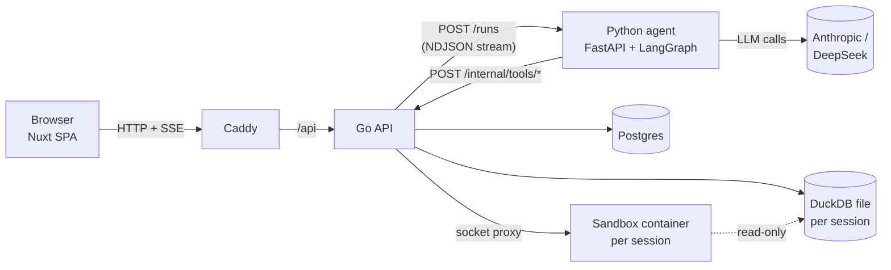

# Data Analyst Agent

Upload a CSV or Parquet file, ask a question in plain English, and watch an AI agent work it out. It inspects the data, writes and runs SQL and Python in a locked-down sandbox, fixes its own errors, draws charts, and explains the answer.

> **Demo video and GIF:** coming in milestone 2.
> **Eval results (Claude vs DeepSeek):** coming in milestone 3.

## Run it

You need Docker. On Linux, gVisor is optional but recommended (see [Sandbox](#sandbox)).

```bash
git clone <this repo> && cd data-analyst-agent
cp .env.example .env          # then set ANTHROPIC_API_KEY (or DEEPSEEK_API_KEY + LLM_PROVIDER=deepseek)
docker compose up --build     # or: make up
```

Open <http://localhost:3000>, click **Retail sales**, and ask *"Why did West revenue drop in Q3 2025?"*

The defaults keep spending low: a cheap model (`claude-haiku-5-5`), and a **$0.50/day** chat cap that the Go API enforces from real token counts. Change both in `.env`.

## Architecture



**The split:** Go owns everything stateful or dangerous: uploads, DuckDB, Postgres, the sandbox, limits and costs. Python owns only the reasoning: the prompt, the LangGraph loop, and the LLM calls. The Python service is stateless, never touches the database or Docker, and runs tools by calling back into Go. Swapping LangGraph for a hand-written loop (planned for v2) only replaces the Python service.

**One question, end to end:**

1. The browser posts the question. Go checks the daily budget, whether a sandbox is free, and the model's price. Postgres's partial unique index allows one running run per session.
2. Go sends Python the question, the table schemas with sample rows, the last few turns of history (with compact tool steps), the model and the limits.
3. LangGraph loops: the model calls `describe_dataset`, `run_sql` or `run_python`; Python forwards each call to Go; Go runs it in the session's sandbox and returns text the model can read. Errors come back as results, so the agent can fix its code and retry.
4. Every step streams back as NDJSON from Python to Go, then as SSE from Go to the browser. Go saves each tool call, keeps the charts, and computes cost from the token counts.
5. A tool-call budget (10 by default) stops runaway loops. When it runs out, the agent must answer with what it has and say so.

The Go⇄Python API is defined once in [`contracts/internal-api.schema.json`](contracts/internal-api.schema.json), and both services' tests validate their payloads against it.

## Sandbox

Agent-written code runs in a container per session, created by Go through a Docker socket proxy:

- no network, 1 CPU, 1 GB memory (no swap), a PID limit, and a 30-second timeout per call that kills the whole process group
- read-only root filesystem, non-root user, all capabilities dropped, `no-new-privileges`
- the session's DuckDB file mounted read-only; writable `/out` (charts) and `/scratch` (intermediate results)
- an explicit environment allowlist, so no secrets reach agent code
- runs under **gVisor** (`runsc`) when installed, otherwise falls back to `runc` with a warning

Each call is a fresh process, so a crash, timeout, or fork bomb can't leave state behind. If code hangs, the container is thrown away and recreated. These behaviours are covered by integration tests against real Docker (`api/internal/sandbox/manager_test.go`).

**Honest limits:** the socket proxy restricts which Docker endpoints Go can reach, but "create container" is still a powerful permission, so a compromised API process remains serious. gVisor is what stops a container escape. On Linux, the host can reach containers on a bridge network by IP. The agent service publishes no port, and every internal call needs a shared token.

## Development

```bash
make test          # sandbox runner + agent + Go (Go tests need Docker: Postgres via testcontainers, real sandboxes)
make lint
make typecheck     # Nuxt
cd web && npm run dev   # UI on :3000 against the Go API on :8080 (from `docker compose up`)
```

| Path | What |
|---|---|
| `api/` | Go service: public API, internal tool API, sandbox manager, DuckDB loading, costs |
| `agent/` | Python agent service: LangGraph graph, prompts, provider factory |
| `sandbox/` | Sandbox image and `runner.py` (executes one SQL or Python call) |
| `web/` | Nuxt UI |
| `contracts/` | Internal API schema |
| `config/pricing.yaml` | Per-model prices used for the spend cap |
| `deploy/` | Production compose override and Caddyfile (deploy-ready; v1 runs locally) |
| `docs/specs/` | Design doc |

## Data and privacy

Column names, sample rows, and query results are sent to the model provider you configure (DeepSeek's API is hosted in China). Don't upload sensitive data. Sessions, their files, and their sandboxes are deleted after 24 hours.
